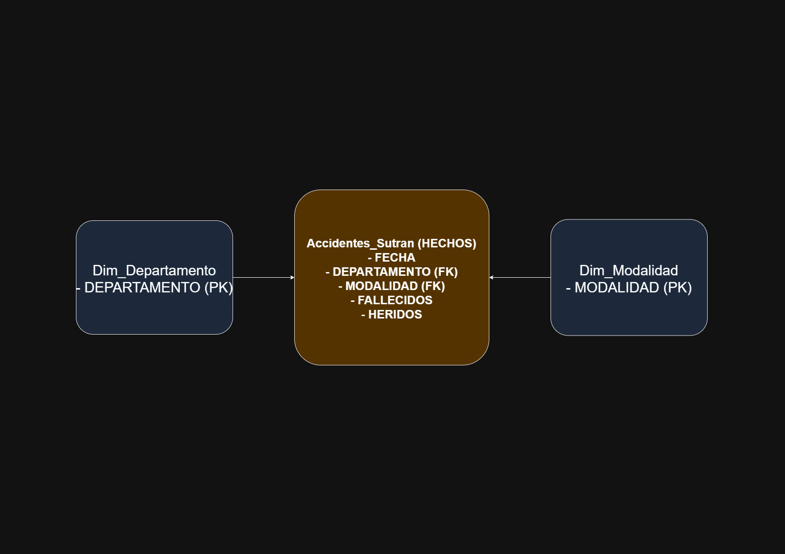

# Accidentes de tránsito en carreteras del Perú · SQL Server y Power BI

Laboratorio del curso **Análisis de Datos** (Universidad Privada del Norte, 2026). Se limpian, integran y analizan los accidentes de tránsito registrados en carreteras del Perú entre 2020 y 2021, usando Power Query, SQL Server y Power BI.

<!-- Opcional: agrega aquí una línea con tu aporte personal, por ejemplo: "Mi aporte: ..." -->

## Qué se hizo

1. **Limpieza y estandarización (Power Query):** se corrigió el formato de fechas (de texto a fecha) y horas, y se reemplazaron los valores nulos por `0` y los valores `N.I.` por `NO REGISTRADO`.
2. **Integración con SQL Server:** se crearon dos tablas dimensión (`Dim_Departamento` y `Dim_Modalidad`) y una consulta con **2 `INNER JOIN` y 1 `GROUP BY`**.
3. **Indicadores (KPIs):** se calcularon 3 KPIs y se verificaron con dos métodos distintos (total general frente a la suma de subtotales por departamento).
4. **Modelo de datos:** se diseñó un modelo estrella simple (una tabla de hechos y dos dimensiones).
5. **Validación:** se comprobó la coherencia de los tipos de datos con `INFORMATION_SCHEMA.COLUMNS`.

## Resultados

| KPI | Valor |
|---|---|
| Accidentes registrados | 8,120 |
| Personas fallecidas | 1,375 |
| Personas heridas | 10,643 |

## Modelo de datos



## Consulta principal

```sql
SELECT
    d.DEPARTAMENTO AS Departamento,
    m.MODALIDAD    AS Tipo_Accidente,
    COUNT(a.FECHA) AS Total_Accidentes
FROM Accidentes_Sutran a
INNER JOIN Dim_Departamento d ON a.DEPARTAMENTO = d.DEPARTAMENTO
INNER JOIN Dim_Modalidad    m ON a.MODALIDAD    = m.MODALIDAD
GROUP BY d.DEPARTAMENTO, m.MODALIDAD
ORDER BY Total_Accidentes DESC;
```

## Datos

- **Fuente:** Superintendencia de Transporte Terrestre de Personas, Carga y Mercancías (SUTRAN), datos abiertos de accidentes de tránsito en carreteras, 2020-2021.
- **Licencia:** Open Data Commons Attribution License.
- **Fecha de descarga:** 08/04/2026.
- **Campos:** fecha, hora, departamento, código de vía, kilómetro, modalidad del accidente, fallecidos y heridos. Están descritos en el diccionario de datos de la carpeta `datos/`.

## Estructura del repositorio

```
├── UAIN1008V_Tema2_YanelaAcori.sql      # Script de SQL Server (dimensiones, JOIN y GROUP BY)
├── UAIN1008V_Tema2_AcoriYanela.pbix     # Proyecto de Power BI
├── datos/                               # Datos originales, datos limpios y diccionario de datos
├── entregables/                         # Informe en PDF y capturas de los resultados
└── evidencias/                          # Diagrama del modelo de datos
```

## Cómo reproducirlo

1. En SQL Server, crea una base de datos llamada `Lab2_Accidentes`.
2. Importa `datos/Accidentes_Limpios.csv` como una tabla llamada `Accidentes_Sutran`.
3. Ejecuta el script `UAIN1008V_Tema2_YanelaAcori.sql`.
4. Abre el archivo `.pbix` con Power BI Desktop. Si pide la ruta de los datos, actualízala en Power Query (Transformar datos → Editor avanzado).

## Herramientas

SQL Server (T-SQL) · Power BI · Power Query · Modelado de datos (esquema estrella)

## Equipo

Trabajo grupal del curso Análisis de Datos:

- Luis Alfonso Vásquez Pino
- Leonardo Sebastian Campos Cango
- Tomasa Marilu Panta Chunga
- Yanela Liz Acori Sanchez
